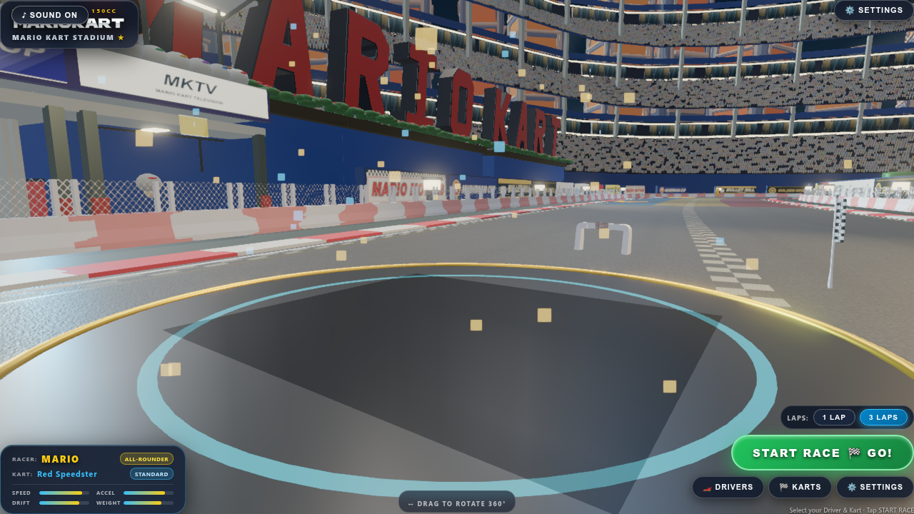
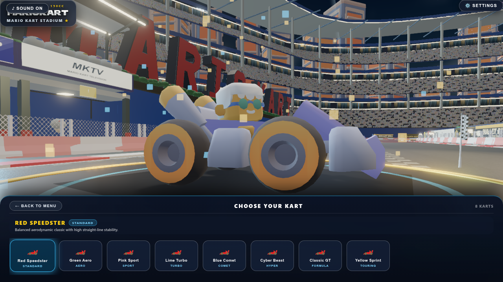
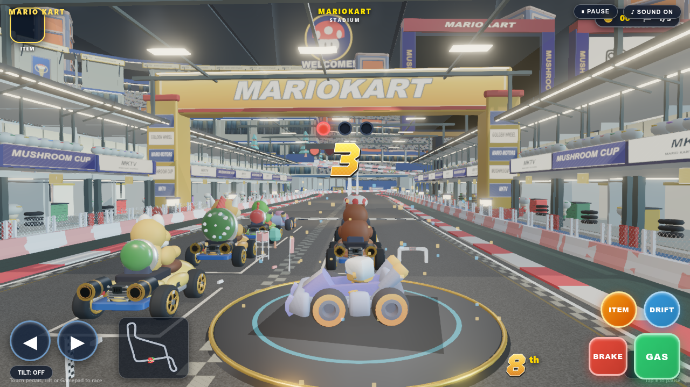

# Mario Kart (Android)

[](https://github.com/mizan989/mario-kart/releases)
[](https://github.com/mizan989/mario-kart)
[-orange.svg)](https://developer.android.com/about/versions/oreo)
[-green.svg)](https://developer.android.com)
[](https://github.com/mizan989/mario-kart)
[](https://github.com/mizan989/mario-kart/actions)

A high-performance 3D Mario Kart racing game engineered specifically for Android devices, including mobile phones, tablets, foldables, Chromebooks, and Android TVs.

- **Game Name:** Mario Kart
- **Package Name:** `com.mizan.mariokart`
- **Version:** `1.0.0` (versionCode `3`)
- **Orientation:** Sensor Landscape (Horizontal form factor)
- **Minimum SDK:** 26 (Android 8.0 Oreo)
- **Target SDK:** 36 (Android 16)
- **Release Size:** ~6.6 MB (Zero external downloads, fully self-contained)

---

## 📸 Visual Showcase & Release Evidence

| 1. High-Definition 3D Main Menu | 2. Character Showcase Pedestal |
| :---: | :---: |
|  |  |
| **3. Kart Customization Showcase** | **4. Scalable Graphics Settings** |
|  |  |
| **5. Racing Gameplay & Drift Action** | **6. Third-Person Chase Camera** |
|  |  |
| **7. Touch HUD & Controls** | **8. Race Completion & Results** |
|  |  |

---

## 📥 Download & Install

Download the latest signed release APK directly from [GitHub Releases](https://github.com/mizan989/mario-kart/releases):

- **[Download Mario Kart v1.0.0 APK](https://github.com/mizan989/mario-kart/releases/download/v1.0.0/MarioKart-v1.0.0.apk)**

Or install via ADB:
```bash
adb install -r app/build/outputs/apk/release/app-release.apk
```

---

## 🎮 Game Features

- **Real-Time 3D Engine & Physics:**
  - Built with custom hardware-rasterized Three.js WebGL rendering optimized for 60 FPS on mobile GPUs.
  - **8 Playable Racers:** Mario, Luigi, Peach, Yoshi, Bowser, Donkey Kong, Toad, and Koopa Troopa.
  - **Mario Kart Stadium:** Complete 3D track featuring anti-gravity banked curves, glider flight zones, jump ramps, boost pads, coins, and mystery item boxes.
  - **Authentic Drift System:** Charge mini-turbo sparks while cornering through 3 tiers:
    - 🔵 **Mini-Turbo (Blue sparks)**
    - 🟠 **Super Mini-Turbo (Orange sparks)**
    - 🟣 **Ultra Mini-Turbo (Purple sparks)**
  - **Full Item Arsenal:** Green Shell (ricochet), Red Shell (homing), Spiny Blue Shell (1st-place tracker), Banana Peel (rear hazard), Dash Mushroom (burst boost), and Super Star (invincibility & rainbow aura).
  - **Competitive AI:** 8-racer field with rubber-banding, racing line intelligence, and strategic weapon deployment.

- **High-Definition 3D Starting Screen & Showcase:**
  - Interactive real-time 3D menu scene with orbital camera, stadium spotlights, and particle dust motes.
  - Character and Kart selection drawers with real-time 3D model hot-swapping and persistence.
  - Direct audio controls for Master, Music, and SFX volume sliders.

- **Offline Procedural Audio:**
  - 100% offline procedural Web Audio synthesizer (no large audio downloads or missing codecs).
  - Dynamic multi-oscillator engine synthesizer with real-time speed and RPM pitch modulation.
  - Sound effects for drift sparks, turbo release whoosh, shell ricochets, explosions, item roulette chime, and victory fanfares.

- **Native Android Hardware Integration:**
  - **Haptic Vibration Feedback:** Native haptics via Android `Vibrator` / `VibratorManager` on kart collisions, rocket starts, drift boosts, and shell impacts.
  - **Sticky Immersive Fullscreen:** Automatically hides Android system navigation and status bars for uninterrupted gameplay.
  - **Android TV & Leanback Support:** Declares Android TV leanback launcher banners (`tv_banner.png`) and fully maps Android TV remote D-pads and gamepad controllers.
  - **Hardened Touch Control Lifecycle:** Pointer capture, touch cancellation, window blur handling, and auto-hiding when a physical gamepad is connected.
  - **Robust Android Back Navigation:** Full lifecycle handling for Android physical/gesture back button across drivers, karts, settings, active racing, pause modal, and results screens.

---

## ⚙️ Graphics Settings & Scalability

The game includes automatic WebGL GPU capability detection and 4 selectable quality presets in the Settings menu:

| Preset | Resolution Scale | Shadows | Max Lights | Antialiasing | Anisotropic | Target Hardware |
| :--- | :--- | :--- | :--- | :--- | :--- | :--- |
| **Low** | 0.85x | Disabled | 2 | None | 1x | Older devices, entry-level phones |
| **Medium** | 1.0x | 1024px | 4 | FXAA | 2x | Mid-range devices |
| **High** | 1.0x | 2048px | 6 | FXAA | 4x | Flagship phones, modern tablets |
| **Ultra** | 1.25x | 2048px | All (8+) | FXAA | 8x | High-end gaming devices, Apple Silicon / Snapdragons |

---

## 🕹️ Controls Guide

### 1. Android Mobile & Tablets (Touchscreen)
Touch controls automatically activate when racing on a touchscreen device:
- **Steer Left / Right (`◀` / `▶`):** Pedals on the bottom left.
- **Gas / Accelerate (`GAS`):** Large green pedal on the bottom right.
- **Brake / Reverse (`BRAKE`):** Red pedal on the bottom right.
- **Drift (`DRIFT`):** Blue button on the bottom right (hold into turns to charge sparks, release for turbo boost).
- **Use Item (`ITEM`):** Glowing orange button on the bottom right.
- **Tilt Steering (`TILT`):** Toggle tilt steering on/off to steer by rotating your device like a steering wheel.
- **Pause (`⏸ PAUSE`):** Top bar button to pause and resume.

### 2. Android TV Remote & Gamepads (Bluetooth / USB)
The game detects connected gamepads and TV remotes, hiding on-screen touch pedals automatically:

| Action | Gamepad (Xbox / PlayStation / Generic) | Android TV Remote |
| :--- | :--- | :--- |
| **Steer** | Left Analog Stick / D-Pad Left & Right | D-Pad Left / Right |
| **Accelerate (Gas)** | **A** (South) / Right Trigger (**RT / R2**) | D-Pad Center / Enter |
| **Brake / Reverse** | **B** (East) / Left Trigger (**LT / L2**) | D-Pad Down |
| **Drift (Mini-Turbo)** | Right Bumper (**RB / R1**) / **X** (West) | — |
| **Use Item** | Left Bumper (**LB / L1**) / **Y** (North) | D-Pad Up |
| **Pause Game** | **Start** / Menu button | Back button |
| **Menu Confirm** | D-Pad + **A** button | D-Pad + Center / Enter |

### 3. Keyboard (Chromebook / Emulator / Debug)
- **Steer:** `←` / `→` or `A` / `D`
- **Gas:** `Z` or `↑` or `W`
- **Brake / Reverse:** `X` or `↓` or `S`
- **Drift:** `Shift` (Left or Right)
- **Item:** `Space`
- **Pause:** `Escape` or `P`

---

## 🛠️ Building & Testing from Source

### Prerequisites
- JDK 17 or higher
- Android SDK with Build-Tools `36.0.0` and API Level `36`
- Node.js 18+ (for running JS unit test suites)

### Build Commands
```bash
# Clone the repository
git clone https://github.com/mizan989/mario-kart.git
cd mario-kart

# Build signed Release APK
./gradlew assembleRelease

# Build Debug APK
./gradlew assembleDebug

# Output APKs:
# app/build/outputs/apk/release/app-release.apk (Release)
# app/build/outputs/apk/debug/app-debug.apk (Debug)
```

### Verification & Test Suite
```bash
# Run JS unit tests (track math, geometry, camera, physics, menus)
npm test

# Run JS syntax check
npm run check

# Run full visual regression and asset verification
npm run verify

# Run Kotlin unit tests
./gradlew test
```

---

## 📄 License & Attribution

This project is developed for educational and portfolio demonstration purposes.
- All 3D models, textures, animations, and shaders are custom procedural/authored assets.
- All audio is generated procedurally via the Web Audio API.
- Mario Kart and associated character names and likenesses are copyright and registered trademarks of Nintendo Co., Ltd.

For detailed release history and technical milestones across all development phases, consult [RELEASE_NOTES.md](RELEASE_NOTES.md).
