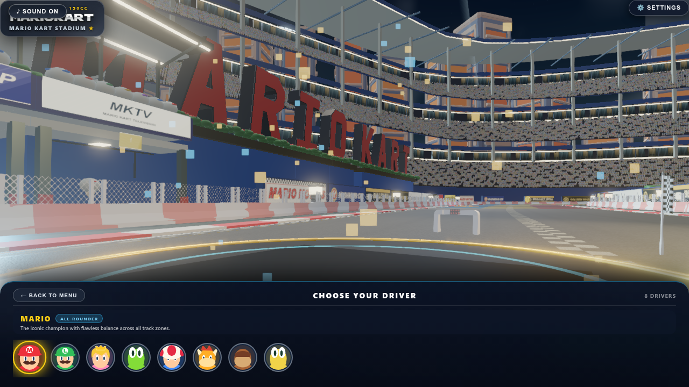
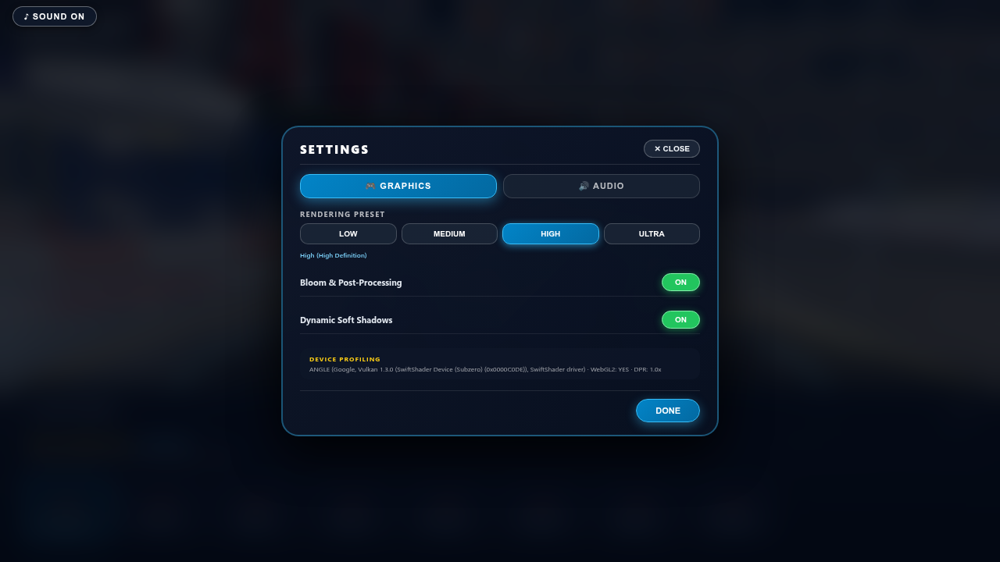

# Mario Kart (Android)

[](https://github.com/builtbyhand/mario-kart/releases)
[](https://github.com/builtbyhand/mario-kart)
[-orange.svg)](https://developer.android.com/about/versions/oreo)
[-green.svg)](https://developer.android.com)
[](https://github.com/builtbyhand/mario-kart)
[](https://github.com/builtbyhand/mario-kart/actions)

A high-performance 3D Mario Kart racing game engineered specifically for Android devices, including mobile phones, tablets, foldables, Chromebooks, and Android TVs.

- **Game Name:** Mario Kart
- **Package Name:** `com.mizan.mariokart`
- **Version:** `1.3.0` (`versionCode 6`)
- **Orientation:** Sensor Landscape (Horizontal form factor)
- **Minimum SDK:** 26 (Android 8.0 Oreo)
- **Target SDK:** 35 (Android 15)
- **Compile SDK:** 36 (Android 16)
- **Distribution:** 100% self-contained offline APK served via Android `WebViewAssetLoader`

---

## 📸 Headless Visual Regression Captures (1280 × 720 HD Landscape)

> [!NOTE]
> The screenshots below are headless visual regression captures rendered at 1280 × 720 via Chromium SwiftShader using the project's automated capture tool (`scripts/capture-release-screenshots.js`). They validate visual presentation, shaders, PBR materials, responsive UI overlays, and HUD styling. Gameplay mechanics (touch lifecycle, physics, barrier collision, loop closure) are verified separately by automated unit and integration suites.

| 1. High-Definition 3D Main Menu | 2. Character Showcase Pedestal |
| :---: | :---: |
|  |  |
| **3. Kart Customization Showcase** | **4. Scalable Graphics Settings** |
|  |  |
| **5. Racing Gameplay & Drift Action** | **6. Third-Person Chase Camera** |
|  |  |
| **7. Touch HUD Overlay** | **8. Race Completion Standings** |
|  |  |

---

## 📥 Download & Installation

### Official Releases
Signed APK releases are automatically built, verified, and published on [GitHub Releases](https://github.com/builtbyhand/mario-kart/releases) via `.github/workflows/release.yml` whenever a `v*` tag is pushed.

### Installing a Local Release Build via ADB
You can build and install the release APK directly to a connected Android device or emulator:
```bash
./gradlew assembleRelease
adb install -r app/build/outputs/apk/release/app-release.apk
```

---

## 🔐 Release Signing Configuration

The project implements a dedicated release signing configuration in `app/build.gradle.kts` and does **not** depend on the Android debug certificate for release builds:

1. **Production Signing:**
   Configured via environment variables or Gradle properties:
   - `RELEASE_STORE_FILE` (path to production `.jks` / `.keystore`)
   - `RELEASE_STORE_PASSWORD`
   - `RELEASE_KEY_ALIAS`
   - `RELEASE_KEY_PASSWORD`
   In GitHub Actions (`.github/workflows/release.yml`), when `RELEASE_KEYSTORE_BASE64`, `RELEASE_STORE_PASSWORD`, `RELEASE_KEY_ALIAS`, and `RELEASE_KEY_PASSWORD` secrets are configured, the workflow signs with the production keystore; otherwise it signs with the repository test-release keystore, verifies APK Signature Scheme v2 with `apksigner`, generates `checksums-sha256.txt`, and publishes the release artifacts.

2. **Local Test-Release Signing:**
   When production signing credentials are not present locally, Gradle automatically creates and uses an uncommitted local test-release keystore (`CN=Mario Kart Local Test Release, OU=QA Test, O=Mario Kart Project, C=US`, alias `mariokart-test-release`) stored in `app/build/signing/`. This produces an installable release-typed APK without relying on the debug key.

3. **Signature Verification (`apksigner`):**
   ```bash
   apksigner verify --verbose --print-certs app/build/outputs/apk/release/app-release.apk
   ```
   - Scheme: Verified using APK Signature Scheme v2.
   - Debug Certificate Status: Confirmed **not** signed with the Android debug certificate (`CN=Android Debug`).

---

## 🎮 Game Features

- **Selectable Courses (`TRACK` Toggle in Main Menu):**
  - **MK Stadium (Default):** Full 3D stadium course (`models/stadium-source.glb`, texture-optimized to 9.28 MB for mobile GPU VRAM) driven by a measured 3D `roadMesh` (`stadium-route.json`), featuring an anti-gravity banked hairpin, glider ramp jump, boost pads, jumbotrons, and animated spectator crowds.
  - **Circuit:** Lightweight procedural stadium circuit (`world.js` + `track.js`) with 28 instanced environment props, dynamic spotlights, and underpass geometry.
- **Racers & Vehicles:**
  - **8 Playable Racers:** Mario, Luigi, Peach, Yoshi, Toad, Bowser, Donkey Kong, and Koopa Troopa.
  - **9 Kart Options:** Select **Classic Kart** (character-matched `*-source.glb` models with procedural driver/head sway and anti-gravity wheel rim shaders) or choose from 8 customizable karts (*Red Speedster*, *Green Aero*, *Pink Sport*, *Lime Turbo*, *Blue Comet*, *Cyber Beast*, *Classic GT*, *Yellow Sprint*).
- **Real-Time 3D Engine & Physics:**
  - Hardware-rasterized Three.js WebGL rendering with AgX tone mapping, soft shadows, bloom post-processing, and FXAA.
  - **3-Tier Drift System:** Mini-Turbo (Blue), Super Mini-Turbo (Orange), and Ultra Mini-Turbo (Purple).
  - **Item Arsenal & Competitive AI:** Green Shell, Red Shell, Spiny Blue Shell, Banana Peel, Dash Mushroom, Super Star, and 8-racer AI field with racing line tracking and rubber-banding.
- **Sampled Audio Engine & UI Typography:**
  - **104-Cue Sampled OGG Audio Pack (`audio/sampled/`):** Dynamic frontrunning music stems (`race`/`raceLead`, `final`/`finalLead`), multi-layer engine RPM/boost loops, terrain & drift loops, UI feedback cues, results tally audio, and character-specific voice clips — with automatic synthesized Web Audio fallback.
  - **Custom Racing Typography:** Bundled `counter.woff` and `message.woff` display fonts for HUD readouts, lap/position counters, banners, and menus.
- **Native Android Hardware Integration:**
  - Native haptic vibration (`Vibrator` / `VibratorManager`), sticky immersive fullscreen, Android TV Leanback & D-pad/gamepad support, hardened multi-touch pointer capture lifecycle, and full Android back-button navigation across menus and pause/results states.

---

## ⚙️ Graphics Settings & Scalability

The game includes automatic WebGL GPU capability detection and 4 selectable quality presets in the Settings menu:

| Preset | Resolution Scale | Shadows | Max Lights | Antialiasing | Anisotropic | Target Hardware |
| :--- | :--- | :--- | :--- | :--- | :--- | :--- |
| **Low** | 0.85x | Disabled | 2 | None | 1x | Older devices, entry-level phones |
| **Medium** | 1.0x | 1024px | 4 | FXAA | 2x | Mid-range devices |
| **High** | 1.0x | 2048px | 6 | FXAA | 4x | Flagship phones, modern tablets |
| **Ultra** | 1.25x | 2048px | All (8+) | FXAA | 8x | High-end gaming devices |

---

## 🕹️ Controls Guide

### 1. Android Mobile & Tablets (Touchscreen)
Touch controls automatically activate when racing on a touchscreen device:
- **Steer Left / Right (`◀` / `▶`):** Pedals on the bottom left.
- **Gas / Accelerate (`GAS`):** Green pedal on the bottom right.
- **Brake / Reverse (`BRAKE`):** Red pedal on the bottom right.
- **Drift (`DRIFT`):** Blue button on the bottom right (hold into turns to charge sparks, release for turbo boost).
- **Use Item (`ITEM`):** Orange button on the bottom right.
- **Tilt Steering (`TILT`):** Toggle tilt steering on/off to steer by rotating your device like a steering wheel.
- **Pause (`⏸ PAUSE`):** Top bar button to pause and resume.

### 2. Android TV Remote & Gamepads (Bluetooth / USB)
The game detects connected gamepads and TV remotes, hiding on-screen touch pedals automatically:

| Action | Gamepad (Xbox / PlayStation / Generic) | Android TV Remote |
| :--- | :--- | :--- |
| **Steer** | Left Analog Stick / D-Pad Left & Right | D-Pad Left / Right |
| **Accelerate (Gas)** | **A** (South) / Right Trigger (**RT / R2**) | D-Pad Center / Enter |
| **Brake / Reverse** | **B** (East) / Left Trigger (**LT / L2**) | D-Pad Down |
| **Drift (Mini-Turbo)** | Right Bumper (**RB / R1**) / **X** (West) | — |
| **Use Item** | Left Bumper (**LB / L1**) / **Y** (North) | D-Pad Up |
| **Pause Game** | **Start** / Menu button | Back button |
| **Menu Confirm** | D-Pad + **A** button | D-Pad + Center / Enter |

### 3. Keyboard (Chromebook / Emulator / Debug)
- **Steer:** `←` / `→` or `A` / `D`
- **Gas:** `Z` or `↑` or `W`
- **Brake / Reverse:** `X` or `↓` or `S`
- **Drift:** `Shift` (Left or Right)
- **Item:** `Space`
- **Pause:** `Escape` or `P`

---

## 🧪 Testing Matrix & Verification

### Automated Test Suites
1. **JavaScript Unit Tests (`npm test`):**
   - **101 passing tests** verifying track mathematics, 3D barrier seams, `stadium-route.json` road mesh loop & anti-gravity/glide validation, `stadium-source.glb` and `*-source.glb` model integrity, sampled OGG audio loading, kart acceleration & drift dynamics, touch pointer capture recovery, and GPU capability presets.
2. **JavaScript Syntax Check (`npm run check`):**
   - Full AST syntax validation of all runtime game scripts.
3. **Kotlin Unit Tests (`./gradlew test`):**
   - Android native bridge, WebAppInterface, activity lifecycle, and input dispatching tests.
4. **Visual Regression Verification (`npm run verify`, `scripts/capture-release-screenshots.js`):**
   - Headless Chromium captures across karts, environment, menus, and HUD.
5. **Android Back Navigation Suite (`scripts/verify-back-navigation-avd.js`):**
   - Automated testing of physical/gesture back button handling across UI navigation states.

---

## 🛠️ Building & Testing from Source

### Prerequisites
- JDK 17 or higher
- Android SDK with Build-Tools `36.0.0`, `compileSdk = 36`, and `targetSdk = 35`
- Node.js 18+ (for running JS unit test suites)

### Build Commands
```bash
# Clone the repository
git clone https://github.com/builtbyhand/mario-kart.git
cd mario-kart

# Build signed Release APK
./gradlew assembleRelease

# Build Debug APK
./gradlew assembleDebug

# Output APKs:
# app/build/outputs/apk/release/app-release.apk (Release)
# app/build/outputs/apk/debug/app-debug.apk (Debug)
```

### Verification & Test Suite
```bash
# Run JS unit tests
npm test

# Run JS syntax check
npm run check

# Run Kotlin unit tests
./gradlew test
```

---

## 📄 License & Attribution

This project is developed for educational and portfolio demonstration purposes.
- Portions of the game logic are derived from OpenWii (MIT License); see [THIRD_PARTY_NOTICES.md](THIRD_PARTY_NOTICES.md).
- Mario Kart and associated character names, models, audio, and likenesses are copyright and registered trademarks of Nintendo Co., Ltd.

For historical phase notes, consult [RELEASE_NOTES.md](RELEASE_NOTES.md).
