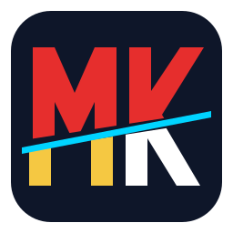
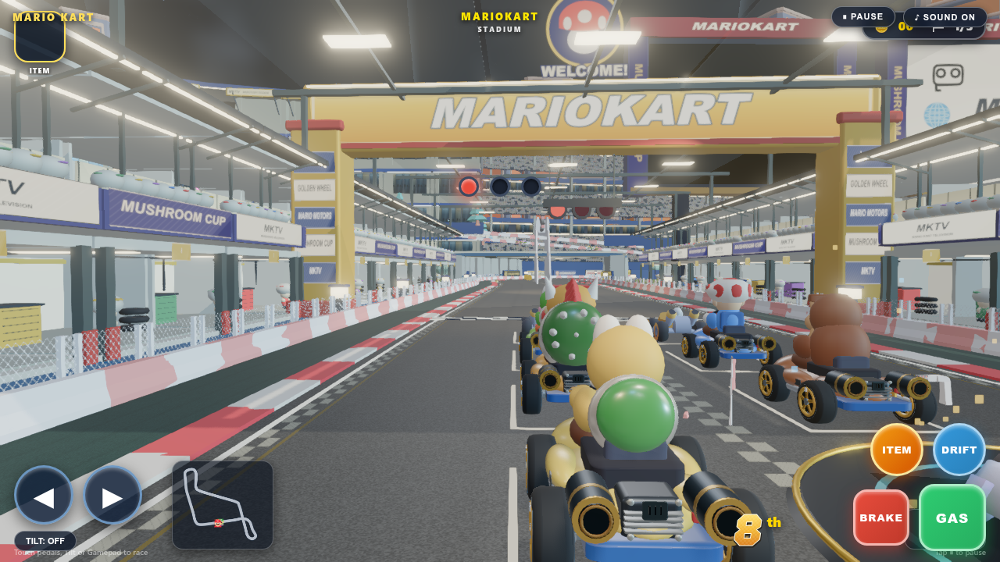
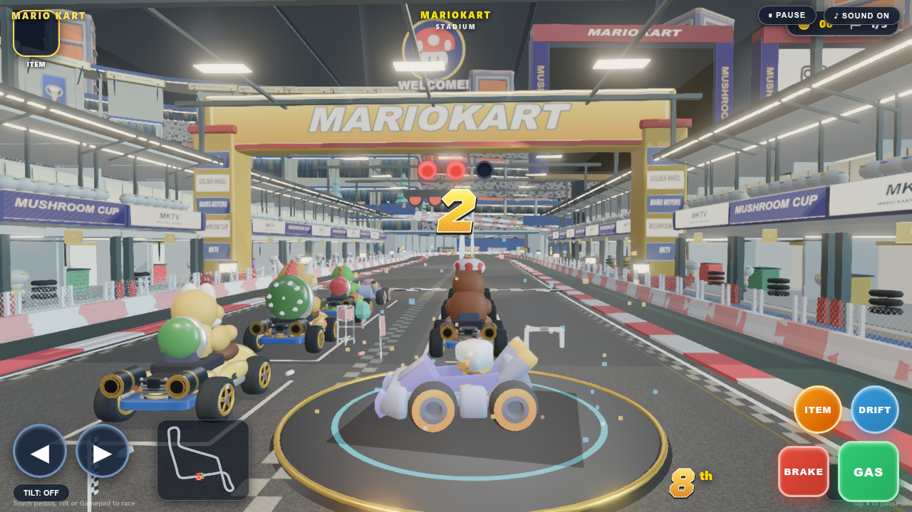
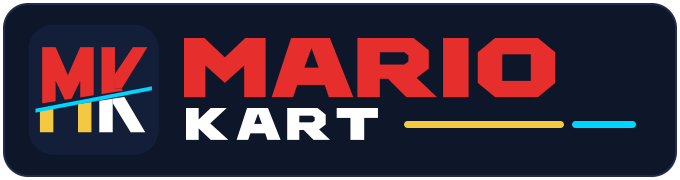
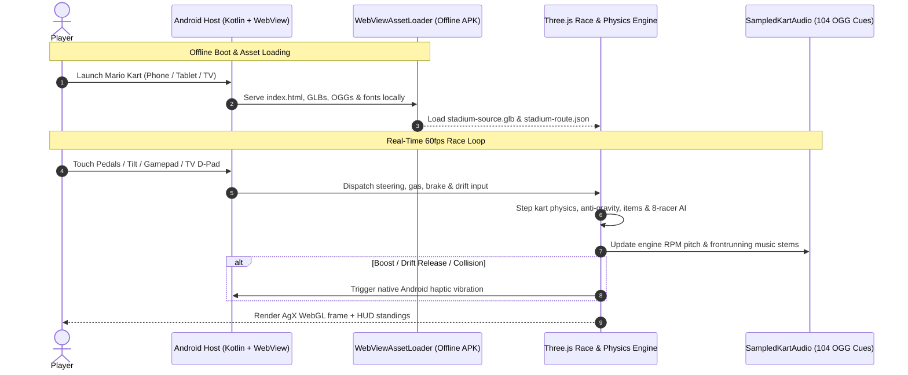

<p align="center">
  <a href="https://github.com/builtbyhand/mario-kart">
    
  </a>
</p>

<div align="center">

# Mario Kart (Android)

### High-performance 3D kart racing engineered for Android phones, tablets, foldables, Chromebooks, and Android TV. Real-time Three.js WebGL rendering, 3-tier drift physics, 104-cue sampled OGG audio, and 100% offline APK delivery.

<br/>

<a href="#-quick-start"></a>
<a href="https://github.com/builtbyhand/mario-kart/releases"></a>
<a href="https://github.com/builtbyhand/mario-kart/issues"></a>

<a href="#-mario-kart-overview"></a>
<a href="#-runtime--race-loop-flow"></a>

<a href="https://github.com/builtbyhand/mario-kart/releases"></a>
<a href="https://developer.android.com/about/versions/oreo"></a>
<a href="https://developer.android.com"></a>
<a href="https://github.com/builtbyhand/mario-kart"></a>
<a href="https://github.com/builtbyhand/mario-kart/actions"></a>

</div>

> [!TIP]
> **100% Self-Contained Offline Racing!** Mario Kart (`com.mizan.mariokart`, v`1.3.0`) bundles all 3D GLB courses, karts, 104-cue sampled OGG audio, and custom racing fonts directly inside the APK via Android `WebViewAssetLoader` — zero network requests, zero accounts, and instant sensor-landscape play on mobile and Android TV. [Build & install in under 60 seconds](#-quick-start).

---

## Mario Kart Overview

**Mario Kart (Android)** is a hardware-accelerated 3D arcade kart racer built with a native **Kotlin** Android host and a custom **Three.js WebGL** game engine. Designed for responsive sensor-landscape play across phones, tablets, Chromebooks, and Android TV Leanback, it pairs AgX tone-mapped PBR rendering and bloom post-processing with native haptic feedback, multi-touch pointer capture, and full D-pad/gamepad support.

Unlike stripped-down mobile clones, every race runs locally with zero external asset streaming: players can toggle between **MK Stadium** (`stadium-source.glb`, texture-optimized to 9.28 MB for mobile GPU VRAM) and the procedural **Circuit** track, pick from 8 racers and 9 karts (including character-matched **Classic Kart** models with procedural driver sway), and race competitive 8-racer AI fields.

**Key Capabilities:**

- **Selectable Courses (`TRACK` Toggle)** — Race **MK Stadium** (default, driven by a measured 3D `roadMesh` in `stadium-route.json` with an anti-gravity banked hairpin, glider ramp jump, boost pads, jumbotrons, and animated crowds) or switch to the lightweight **Circuit** course (`world.js` + `track.js`).
- **8 Playable Racers & 9 Kart Options** — Mario, Luigi, Peach, Yoshi, Toad, Bowser, Donkey Kong, and Koopa Troopa; choose **Classic Kart** (character-matched `*-source.glb` models with procedural driver/head sway and anti-gravity wheel rim shaders) or 8 customizable karts (*Red Speedster*, *Green Aero*, *Pink Sport*, *Lime Turbo*, *Blue Comet*, *Cyber Beast*, *Classic GT*, *Yellow Sprint*).
- **Real-Time 3D Engine & Physics** — Hardware-rasterized Three.js WebGL with AgX tone mapping, soft shadows, bloom post-processing, FXAA, and a 3-tier drift turbo system (Mini-Turbo Blue, Super Mini-Turbo Orange, Ultra Mini-Turbo Purple).
- **Item Arsenal & Competitive AI** — Green Shell, Red Shell, Spiny Blue Shell, Banana Peel, Dash Mushroom, and Super Star across an 8-racer AI field with racing-line tracking and rubber-banding.
- **104-Cue Sampled OGG Audio & Custom Fonts** — Dynamic frontrunning music stems (`race`/`raceLead`, `final`/`finalLead`), multi-layer engine RPM/boost loops, terrain & drift loops, character voice clips (`audio/sampled/`) with automatic Web Audio synth fallback, plus bundled `counter.woff` and `message.woff` display fonts.
- **Native Android Hardware Integration** — Native haptic vibration (`Vibrator` / `VibratorManager`), sticky immersive fullscreen, Android TV Leanback & D-pad/gamepad support, hardened multi-touch pointer capture, and full Android back-button navigation.

<br>

<div align="center">
  <pre>
┌─────────────────────────────────────────────────────────────────────────────────┐
│                                  MARIO KART                                     │
│      Kotlin Native Host ➔ WebViewAssetLoader ➔ Three.js WebGL ➔ Physics/AI      │
├───────────────────────────────┬─────────────────────────────────────────────────┤
│  📱 Android Native Shell      │  🏎️ 3D Race & Physics Engine                    │
│   • Sensor-landscape & TV UI  │    [MK Stadium / Circuit]                       │
│   • Haptics & Gamepad/D-Pad   │       ├── 3-Tier Drift & Anti-Gravity Zones     │
│   • 100% Offline Asset Bundle │       ├── 8-Racer AI & Item Combat System       │
├───────────────────────────────┼─────────────────────────────────────────────────┤
│  🔊 Sampled Audio Engine      │  🎨 Scalable Mobile Renderer                    │
│   • 104 OGG stems & voice SFX │    • AgX Tone Mapping, Bloom & FXAA             │
│   • Web Audio synth fallback  │    • 4 Auto/Manual GPU Presets (Low ➔ Ultra)    │
└───────────────────────────────┴─────────────────────────────────────────────────┘
  </pre>
</div>

---

## UI & Gameplay Preview

<p align="center">
  
</p>

<div align="center">
  <table>
    <tr>
      <td width="50%" align="center">
        
        <br />
        <em>1. High-Definition 3D Main Menu</em>
      </td>
      <td width="50%" align="center">
        
        <br />
        <em>2. Character Showcase Pedestal</em>
      </td>
    </tr>
    <tr>
      <td width="50%" align="center">
        
        <br />
        <em>3. Kart Customization Showcase</em>
      </td>
      <td width="50%" align="center">
        
        <br />
        <em>4. Scalable Graphics Settings</em>
      </td>
    </tr>
    <tr>
      <td width="50%" align="center">
        
        <br />
        <em>5. Third-Person Chase Camera</em>
      </td>
      <td width="50%" align="center">
        
        <br />
        <em>6. Touch HUD Overlay</em>
      </td>
    </tr>
    <tr>
      <td width="50%" align="center">
        
        <br />
        <em>7. Race Completion Standings</em>
      </td>
      <td width="50%" align="center">
        
        <br />
        <em>8. Velocity MK Brand Identity</em>
      </td>
    </tr>
  </table>
</div>

> [!NOTE]
> Screenshots are headless visual regression captures rendered at `1280 × 720` via Chromium SwiftShader (`scripts/capture-release-screenshots.js`) validating shaders, PBR materials, responsive UI overlays, and HUD styling. Gameplay mechanics are verified separately by automated unit and integration suites.

---

## Runtime & Race Loop Flow



---

## 🚀 Quick Start

### Official GitHub Releases
Signed APK releases are automatically built, verified, and published on [GitHub Releases](https://github.com/builtbyhand/mario-kart/releases) via `.github/workflows/release.yml` whenever a `v*` tag is pushed.

### Building & Installing Locally

**Prerequisites:** JDK 17+, Android SDK (`compileSdk = 36`, `targetSdk = 35`, `minSdk = 26`, Build-Tools `36.0.0`), and Node.js 18+ (for JS test suites).

```bash
# Clone the repository
git clone https://github.com/builtbyhand/mario-kart.git
cd mario-kart

# Build signed Release APK
./gradlew assembleRelease

# Or build Debug APK
./gradlew assembleDebug

# Install Release APK via ADB
adb install -r app/build/outputs/apk/release/app-release.apk
```

---

## ⚙️ Graphics Settings & Scalability

The game includes automatic WebGL GPU capability detection and 4 selectable quality presets in the Settings menu:

| Preset | Resolution Scale | Shadows | Max Lights | Antialiasing | Anisotropic | Target Hardware |
| :--- | :--- | :--- | :--- | :--- | :--- | :--- |
| **Low** | 0.85x | Disabled | 2 | None | 1x | Older devices, entry-level phones |
| **Medium** | 1.0x | 1024px | 4 | FXAA | 2x | Mid-range devices |
| **High** | 1.0x | 2048px | 6 | FXAA | 4x | Flagship phones, modern tablets |
| **Ultra** | 1.25x | 2048px | All (8+) | FXAA | 8x | High-end gaming devices |

---

## 🕹️ Controls Guide

### 1. Android Mobile & Tablets (Touchscreen)
Touch controls automatically activate when racing on a touchscreen device:
- **Steer Left / Right (`◀` / `▶`):** Pedals on the bottom left.
- **Gas / Accelerate (`GAS`):** Green pedal on the bottom right.
- **Brake / Reverse (`BRAKE`):** Red pedal on the bottom right.
- **Drift (`DRIFT`):** Blue button on the bottom right (hold into turns to charge sparks, release for turbo boost).
- **Use Item (`ITEM`):** Orange button on the bottom right.
- **Tilt Steering (`TILT`):** Toggle tilt steering on/off to steer by rotating your device like a steering wheel.
- **Pause (`⏸ PAUSE`):** Top bar button to pause and resume.

### 2. Android TV Remote & Gamepads (Bluetooth / USB)
The game detects connected gamepads and TV remotes, hiding on-screen touch pedals automatically:

| Action | Gamepad (Xbox / PlayStation / Generic) | Android TV Remote |
| :--- | :--- | :--- |
| **Steer** | Left Analog Stick / D-Pad Left & Right | D-Pad Left / Right |
| **Accelerate (Gas)** | **A** (South) / Right Trigger (**RT / R2**) | D-Pad Center / Enter |
| **Brake / Reverse** | **B** (East) / Left Trigger (**LT / L2**) | D-Pad Down |
| **Drift (Mini-Turbo)** | Right Bumper (**RB / R1**) / **X** (West) | — |
| **Use Item** | Left Bumper (**LB / L1**) / **Y** (North) | D-Pad Up |
| **Pause Game** | **Start** / Menu button | Back button |
| **Menu Confirm** | D-Pad + **A** button | D-Pad + Center / Enter |

### 3. Keyboard (Chromebook / Emulator / Debug)
- **Steer:** `←` / `→` or `A` / `D`
- **Gas:** `Z` or `↑` or `W`
- **Brake / Reverse:** `X` or `↓` or `S`
- **Drift:** `Shift` (Left or Right)
- **Item:** `Space`
- **Pause:** `Escape` or `P`

---

## 🔐 Release Signing Configuration

The project implements a dedicated release signing configuration in `app/build.gradle.kts` and does **not** depend on the Android debug certificate for release builds:

1. **Production Signing:** Configured via `RELEASE_STORE_FILE`, `RELEASE_STORE_PASSWORD`, `RELEASE_KEY_ALIAS`, and `RELEASE_KEY_PASSWORD` (or `RELEASE_KEYSTORE_BASE64` in `.github/workflows/release.yml`), verified with `apksigner` and published with `checksums-sha256.txt`.
2. **Local Test-Release Signing:** When production credentials are absent locally, Gradle automatically generates an uncommitted local test-release keystore in `app/build/signing/` (`alias = mariokart-test-release`).
3. **Signature Verification:**
   ```bash
   apksigner verify --verbose --print-certs app/build/outputs/apk/release/app-release.apk
   ```

---

## 🧪 Testing Matrix & Verification

```bash
# Run JS unit tests (101 passing tests)
npm test

# Run JS AST syntax check
npm run check

# Run Kotlin unit tests
./gradlew test
```

- **JavaScript Unit Tests (`npm test`):** 101 passing tests verifying track mathematics, 3D barrier seams, `stadium-route.json` road mesh loop & anti-gravity/glide validation, `stadium-source.glb` and `*-source.glb` model integrity, sampled OGG audio loading, kart acceleration & drift dynamics, touch pointer capture recovery, and GPU presets.
- **Visual Regression (`npm run verify`, `scripts/capture-release-screenshots.js`):** Headless Chromium captures across karts, environment, menus, and HUD.
- **Android Back Navigation Suite (`scripts/verify-back-navigation-avd.js`):** Automated back-button handling across UI navigation states.

---

## 📄 License & Attribution

This project is developed for educational and portfolio demonstration purposes.
- Portions of the game logic are derived from OpenWii (MIT License); see [THIRD_PARTY_NOTICES.md](THIRD_PARTY_NOTICES.md).
- Mario Kart and associated character names, models, audio, and likenesses are copyright and registered trademarks of Nintendo Co., Ltd.

For historical phase notes, consult [RELEASE_NOTES.md](RELEASE_NOTES.md).
