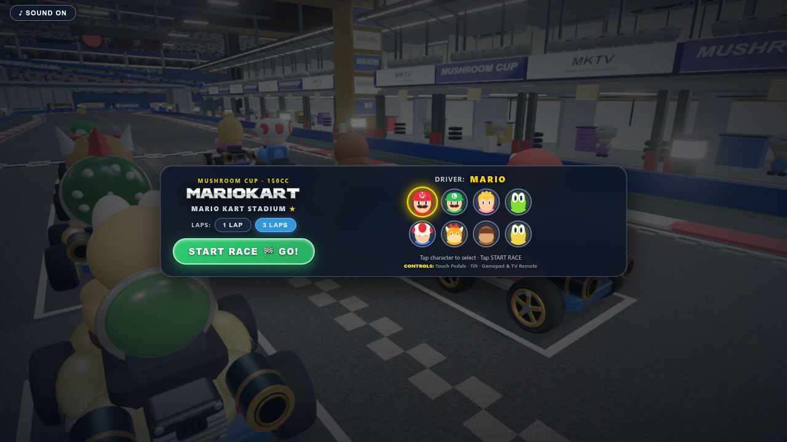

# High-Definition Rendering Engine & Visual Foundation (Phase 2)

**Repository:** [https://github.com/mizan989/mario-kart](https://github.com/mizan989/mario-kart)  
**Platform:** Android Phones & Android TV (Landscape Orientation)  
**Rendering Engine:** Three.js / WebGL inside Android WebView (`WebViewAssetLoader`) + Native Kotlin Integration  
**Visual Style:** Stylized, colorful, high-definition 3D racing inspired by *Mario Kart Tour*

---

## 1. Executive Summary

Phase 2 establishes a high-definition rendering engine and visual foundation for Mario Kart Android. Prior to this phase, the WebGL renderer used basic neutral tone mapping with flat ambient lighting, uncalibrated texture color spaces, rigid non-tracking shadow frustums, uncoupled graphics presets, and static particle buffers.

Phase 2 upgrades the engine with:
1. **Color Management & AgX Filmic Tone Mapping:** Complete sRGB color-space enforcement with `THREE.AgXToneMapping` (exposure `1.15`–`1.20`) delivering rich saturation, highlight rolloff, and preventing overblown washouts.
2. **Soft Shadow Architecture:** Dynamic `THREE.PCFSoftShadowMap` with bias `-0.0002` and normal bias `0.025`, dynamically tracking the player's kart so shadows never clip or vanish across the 3D stadium.
3. **PBR Material Pipeline & Texture Cache:** Centralized PBR material generators (`createKartPaintMaterial`, `createKartMetalMaterial`, `createKartRubberMaterial`, `createBarrierMaterial`, `createGrassMaterial`), procedural pavement with proper tangent normal maps and roughness channels, plus a dedicated `TextureCache` and `MaterialCache` to prevent GPU memory leaks.
4. **Multi-Environment Lighting & Atmosphere Presets:** Centralized `LIGHTING_PRESETS` (`stadium_night`, `sunset_gold`, `sunny_day`) coordinating key lights, fill lights, hemisphere ambients, exponential fog, clear color, and dynamic sky dome shader uniforms.
5. **Configurable Graphics Quality Presets (`LOW`, `MEDIUM`, `HIGH`, `ULTRA`):** Fully operational presets wired to WebGL DPR, resolution scaling (`0.85`–`1.0`), shadow map resolution (`512`–`2048`), texture anisotropy (`1x`–`16x`), and dynamic post-processing passes.
6. **Modular Post-Processing Pipeline (`PostProcessingPipeline`):** Dedicated pipeline manager dynamically enabling `UnrealBloomPass` and `FXAAPass` on High and Ultra tiers, while safely tearing down render targets and passes when switching to Low or Medium.
7. **Connected Particle Effects Budget (`raceEffects`):** Particle pool pre-allocates up to peak capacity (1800) once, dynamically adjusting `geometry.setDrawRange` and simulation iteration loop to match the active quality budget (`300`–`1800`) without runtime buffer allocations or memory leaks.
8. **Robust Hardware Capability Handling & Fallbacks:** Probes WebGL2, float texture sampling, floating-point render targets (`EXT_color_buffer_float` / `EXT_color_buffer_half_float`), clamps anisotropy against device limits, respects max texture dimensions, and gracefully falls back to direct rendering when post-processing is unsupported.
9. **Clean Dependency Management:** Vendored Three.js module is cleanly linked for offline Android packaging and Node.js testing without committing fake `node_modules` installations to Git.

---

## 2. Renderer Architecture & Color Management

### 2.1 WebGL Renderer Configuration
```javascript
const renderer = new THREE.WebGLRenderer({
  canvas,
  antialias: RENDER_CONFIG.antialias,
  powerPreference: "high-performance",
});
renderer.outputColorSpace = THREE.SRGBColorSpace;
renderer.setPixelRatio(RENDER_CONFIG.pixelRatio);
renderer.toneMapping = THREE.AgXToneMapping;
renderer.toneMappingExposure = activeQuality.toneMappingExposure;
renderer.shadowMap.enabled = activeQuality.shadows;
renderer.shadowMap.type = THREE.PCFSoftShadowMap;
```

### 2.2 Tone Mapping & Color Space
- **Three.js Output Color Space:** Configured explicitly as `THREE.SRGBColorSpace`.
- **Tone Mapping:** Switched from `THREE.NeutralToneMapping` to `THREE.AgXToneMapping`. In stylized kart racers inspired by *Mario Kart Tour*, standard Reinhard or neutral tone mappers compress high-luminance colors toward white, losing the distinct saturation of character caps, shells, and boost flames. AgX maintains chromaticity in bright highlights while providing a smooth photographic S-curve shoulder.
- **Exposure:** Tuned per quality tier (`1.10` on Low, `1.15` on Medium, `1.18` on High, `1.20` on Ultra) to balance night stadium illumination with bright neon signs and HUD elements.

### 2.3 Soft Shadows & Frustum Tracking
- **Shadow Map Filter:** `THREE.PCFSoftShadowMap` replaces standard hard PCF shadows, delivering soft, penumbra-filtered shadow edges beneath karts and track barriers.
- **Shadow Frustum:** `left: -32, right: 32, top: 32, bottom: -32, near: 1, far: 160`.
- **Dynamic Tracking:** During the render loop, the directional key light position and shadow camera target continuously track the player kart's world coordinate `(p.x, p.y, p.z)`:
  ```javascript
  key.position.set(p.x - 30, p.y + 60, p.z + 25);
  key.target.position.set(p.x, p.y, p.z);
  key.target.updateMatrixWorld();
  ```
  This ensures optimal shadow map texel density directly around the active race pack, eliminating shadow popping and edge clipping regardless of lap progress.

---

## 3. PBR Material Pipeline & Texture Cache

### 3.1 Centralized Material Generators
`app/src/main/assets/game/materials.js` provides dedicated PBR constructors:
- **`createKartPaintMaterial(options)`:** Stylized automotive car paint using `THREE.MeshPhysicalMaterial`. Features high reflectivity (`0.85`), microfacet roughness (`0.32`), subtle metallic flakes (`0.25`), and clearcoat gloss (`0.80`, roughness `0.12`) to capture the glossy finish of Mario Kart Tour karts.
- **`createKartMetalMaterial(options)`:** High-metalness (`0.88`), low-roughness (`0.28`) `MeshStandardMaterial` for engine blocks, exhaust manifolds, roll cages, and wheel rims.
- **`createKartRubberMaterial(options)`:** Low-reflectance (`metalness: 0.04`), high-roughness (`0.82`) `MeshStandardMaterial` for tire treads and sidewalls.
- **`createBarrierMaterial(options)`:** Satin-finish (`roughness: 0.45`, `metalness: 0.15`) track boundary and safety barrier material.
- **`createGrassMaterial(options)`:** Matte (`roughness: 0.92`, `metalness: 0.0`) infield turf material with optional map binding.

### 3.2 Procedural Pavement & Road Shaders
- **Color Spaces:** The diffuse asphalt texture is tagged with `THREE.SRGBColorSpace`, while tangent normal maps and roughness maps use `THREE.NoColorSpace` (linear) to prevent unwanted gamma curves from distorting surface slope calculations.
- **Anisotropy Clamping:** Dynamically wired to `activeQuality.anisotropy` (`1x` on Low, `4x` on Medium, `8x` on High, `16x` on Ultra), clamped against `capabilities.clampAnisotropy()` to respect hardware limits. Passed directly into `pavementMaps({}, capabilities)` in `world.js` and registered with `setMaterialCapabilities(capabilities)` during initialization, ensuring devices with lower hardware limits (e.g. 4x max) never receive an anisotropy request above their physical limit.
- **Surface Wear Shader Hook:** `roadMaterial` injects custom GLSL into `#include <map_fragment>` calculating tyre grooves, lane wear, and resurfacing patches via physical ribbon UVs without requiring heavy external image maps.

### 3.3 TextureCache & MaterialCache
- Prevents redundant texture recreation across frames.
- Provides `disposeAll()` methods enabling safe GPU memory reclaim upon WebGL context loss or route transitions.

---

## 4. Environmental Lighting & Atmosphere Presets

Centralized in `LIGHTING_PRESETS` in `config.js` and wired into `atmosphere.js` and `game.js`:

| Lighting Preset | Key Light | Fill Light | Hemisphere Light (Sky/Ground) | Fog (Color / Density) | Clear Color | Sky Dome Uniforms |
| :--- | :--- | :--- | :--- | :--- | :--- | :--- |
| **`stadium_night`** (Default) | `#fff3dd` (1.8) | `#77baff` (0.35) | `#a5c8f4` / `#34384a` (0.32) | `#111c30` (0.0011) | `#081325` | Deep navy to glowing horizon, blue arena searchlights |
| **`sunset_gold`** | `#ffaa55` (2.1) | `#9a52cc` (0.45) | `#ffb88c` / `#3b1e2e` (0.45) | `#381a2b` (0.0009) | `#220d1c` | Purple dusk zenith to golden sunset horizon, warm beams |
| **`sunny_day`** | `#fffbf2` (2.3) | `#7ec8f8` (0.55) | `#9be2ff` / `#3e5234` (0.55) | `#76bbe8` (0.0006) | `#58a5dc` | Vibrant azure sky, soft stylized clouds, subtle atmosphere |

Lighting can be selected at runtime via query parameter `?lighting=night|sunset|day` or via runtime bridge `window.__setLightingPreset("sunset_gold")`.

---

## 5. Quality Presets & Dynamic Pipeline Switching

| Setting | Low (Performance) | Medium (Mobile/TV Default) | High (High Definition) | Ultra (Max Quality) |
| :--- | :--- | :--- | :--- | :--- |
| **Device Pixel Ratio (max)** | `1.0` | `1.3` | `1.6` | `2.0` |
| **Resolution Scale** | `0.85` | `1.0` | `1.0` | `1.0` |
| **Shadows Enabled** | `false` | `true` | `true` | `true` |
| **Shadow Map Size** | `512 x 512` | `1024 x 1024` | `1024 x 1024` | `2048 x 2048` |
| **Shadow Map Type** | Basic | PCF Soft | PCF Soft | PCF Soft |
| **Texture Anisotropy** | `1x` | `4x` | `8x` | `16x` |
| **Hardware Antialiasing** | Initial Context | Initial Context | Initial Context | Initial Context |
| **Unreal Bloom Pass** | `false` | `false` | `true` | `true` |
| **FXAA Antialiasing Pass** | `false` | `false` | `true` | `true` |
| **Tone Mapping** | AgX (exp 1.10) | AgX (exp 1.15) | AgX (exp 1.18) | AgX (exp 1.20) |
| **Particle Limit (VFX)** | `300` | `600` | `1200` | `1800` |

### 5.1 Dynamic Pipeline Reconfiguration & Teardown
Switching quality presets via `setQualityPreset(presetKey, engine)` or `window.__setQualityPreset(...)` dynamically manages all rendering subsystems:
- **Medium → High / Ultra:** If the game started without an `EffectComposer` (e.g. on Medium/Low), the pipeline creates the composer on-demand, allocates half-float (or byte) render targets, adds `RenderPass`, creates and attaches `UnrealBloomPass` and `FXAAPass`, and attaches `OutputPass`.
- **High / Ultra → Low / Medium:** Unnecessary post-processing effects are disabled. `postPipeline.teardown()` disposes `renderTarget1`, `renderTarget2`, bloom pass, and FXAA pass, freeing GPU memory. The render loop falls back directly to `renderer.render(scene, camera)`.
- **Shadow Map Disposal:** Toggling shadows off disposes `keyLight.shadow.map` and sets it to `null`, preventing orphaned shadow textures from lingering in VRAM.
- **Hardware Antialiasing Limitation:** Per WebGL specification, hardware MSAA (`antialias: true` on the WebGL context) is an immutable context-creation attribute that cannot be altered on an active WebGL context. The `antialias` property in `QUALITY_PRESETS` specifies the initial context creation preference. At runtime, edge smoothing during dynamic preset transitions is provided by `FXAAPass` in postprocessing on High and Ultra.
- **Camera & Canvas Synchronization:** After a quality change, canvas CSS dimensions, internal buffer dimensions, and `camera.aspect` are recalculated and synchronized (`camera.updateProjectionMatrix()`).

---

## 6. Particle Pool Integration (`raceEffects`)

The particle effects system in `race-effects.js` is directly connected to the active quality budget:
- **Single Pre-allocation:** Sized to peak capacity (1800 particles) once at initialization, completely eliminating runtime GPU buffer reallocations during gameplay.
- **Active Draw Range:** Uses `geometry.setDrawRange(0, activeBudget)` so the GPU vertex pipeline only processes active particles (`300` on Low, `600` on Medium, `1200` on High, `1800` on Ultra).
- **Simulation Loop Clamping:** The CPU update loop only iterates over `0..activeBudget`, providing substantial CPU savings on budget mobile chipsets.
- **Safe Dynamic Resizing:** When reducing particle budget (e.g. High → Low), `setParticleLimit` zeroes out lifetimes, opacities, and sizes of particles outside the new active window, avoiding ghost particles.
- **Resource Disposal:** Provides a clean `dispose()` method freeing geometries and materials from GPU memory.

---

## 7. Hardware Capability Handling & Fallbacks

`detectCapabilities(gl)` probes hardware features:
1. **Float Textures vs Float Render Targets:** Explicitly distinguishes sampling float/half-float textures (`OES_texture_float` / `OES_texture_half_float`) from rendering to floating-point framebuffers (`EXT_color_buffer_float` / `EXT_color_buffer_half_float`).
2. **Anisotropy Clamping:** Clamps requested anisotropy against the hardware maximum (`capabilities.clampAnisotropy()`).
3. **Texture Dimension Clamping:** Clamps texture dimensions against `gl.MAX_TEXTURE_SIZE` (`capabilities.clampTextureSize()`).
4. **Graceful Fallback:** If half-float render targets are unsupported, `PostProcessingPipeline` falls back to `UnsignedByteType` or completely bypasses `EffectComposer` to ensure the game always starts and renders reliably.
5. **Context Loss & Recovery:** Handles `webglcontextlost` by calling `event.preventDefault()` and halting draw calls; `webglcontextrestored` safely rebinds tone mapping and color space.

---

## 8. Dependency Management

- `node_modules` is excluded from Git tracking via `.gitignore`.
- Cross-platform `scripts/ensure-vendor-links.js` automatically creates the required local link to the vendored Three.js module before test execution via npm's `"pretest"` script.
- The offline Android package in `app/src/main/assets/game/vendor/three/` remains completely preserved and self-contained.

---

## 9. Visual Verification (Genuine Evidence)

All screenshots were captured in 1280x720 landscape format using the local headless WebGL environment:

| Preview | Screenshot File | Description |
| :--- | :--- | :--- |
|  | `docs/screenshots/baseline-before.png` | **Baseline Before Phase 2:** Flat neutral tone mapping, harsh shadows, non-calibrated diffuse surfaces. |
|  | `docs/screenshots/phase2-medium.png` | **Medium Preset:** Balanced mobile profile with soft shadows, AgX tone mapping, and clamped DPR. |
|  | `docs/screenshots/phase2-high.png` | **High Preset:** High definition with soft penumbra shadows, bloom on stadium lights, and FXAA. |
|  | `docs/screenshots/phase2-ultra.png` | **Ultra Preset:** 2048 shadow map, 16x anisotropy, bloom, and edge antialiasing. |
|  | `docs/screenshots/phase2-racing.png` | **In-Race Action (Night):** Real-time soft contact shadows beneath karts, asphalt micro-grain, and stadium bloom. |
|  | `docs/screenshots/phase2-day.png` | **Sunny Day Preset:** Bright outdoor daylight lighting, vivid blue sky dome, and aerial perspective fog. |
|  | `docs/screenshots/phase2-sunset.png` | **Sunset Gold Preset:** Twilight sky dome, golden key illumination, and violet ambient fill. |

---

## 10. Test & Verification Results

### 10.1 JavaScript Unit Tests (`npm test`)
```
✔ Quality presets contain valid configuration parameters (1.53ms)
✔ Lighting presets contain valid atmospheric and light values (1.77ms)
✔ Default quality preset returns a valid preset object (0.18ms)
✔ Default lighting preset returns a valid preset object (0.16ms)
✔ detectCapabilities handles null and mock contexts cleanly (0.34ms)
✔ setQualityPreset dynamically switches preset parameters (1.74ms)
✔ Render config exposes proper camera and fog properties (0.27ms)
✔ Asset registry supports registering models and textures with metadata (0.28ms)
✔ Logger handles log levels without throwing (1.96ms)
✔ WheelInput initializes in a clean neutral state (2.67ms)
✔ Touch inputs update and release cleanly without getting stuck (0.37ms)
✔ Gamepad button polling clears upon release (no stuck buttons) (0.32ms)
✔ Native bridge inputs integrate with composite state (0.41ms)
✔ Reset resets all input sources cleanly (0.23ms)
✔ TextureCache manages lifecycle and disposal cleanly (1.04ms)
✔ MaterialCache manages materials and prevents memory leaks (0.26ms)
✔ createKartPaintMaterial returns stylized physical material (1.24ms)
✔ createKartMetalMaterial returns standard metallic material (0.47ms)
✔ createKartRubberMaterial returns low-reflectance tire material (0.26ms)
✔ createBarrierMaterial and createGrassMaterial construct valid materials (0.25ms)
✔ pavementMaps generates textures with proper color spaces (41.36ms)
✔ detectCapabilities accurately identifies float textures vs float render targets (2.05ms)
✔ Anisotropy and texture dimensions clamp against device maximums (0.29ms)
✔ PostProcessingPipeline gracefully falls back when capabilities are unsupported (0.94ms)
✔ PostProcessingPipeline manages lifecycle: Medium -> High -> Low -> Ultra (6.24ms)
✔ setQualityPreset performs full pipeline transitions: Medium -> High -> Low -> Ultra (1.46ms)
✔ raceEffects particle pool connects to quality budget and resizes safely (12.76ms)
✔ Race initializes with correct defaults and characters (1.37ms)
✔ Top speed scales with collected coins (0.18ms)
✔ Turbo tier resolves mini-turbo levels accurately (0.11ms)
✔ Race updates fixed-step accumulator and advances race state (47.25ms)
✔ Seeded random number generator is deterministic (0.82ms)
✔ Track constants and control points are valid (1.00ms)
✔ Math utilities wrap, clamp, angle behave as expected (0.25ms)
✔ Surface sampling returns continuous 3D points with valid coordinates (0.38ms)

ℹ tests 35 | pass 35 | fail 0 | cancelled 0 | duration_ms 260ms
```

### 10.2 Syntax Verification (`npm run check`)
All JavaScript files pass Node.js bytecode syntax check cleanly.

### 10.3 Gradle Tests & Debug Build (`./gradlew test assembleDebug`)
```
BUILD SUCCESSFUL in 1s
43 actionable tasks: 3 executed, 40 up-to-date
```

---

## 11. Known Limitations & Next Steps

1. **3D Character & Kart Models:** Currently, karts are generated via procedural meshes and composite primitives. Sourcing and loading optimized, non-infringing 3D GLB/glTF character and kart models is scheduled for Phase 3 and Phase 4.
2. **Dynamic In-Game Quality Selector UI:** The quality presets are fully operational and can be set via URL parameters (`?quality=...&lighting=...`) or via API (`window.__setQualityPreset(...)`). A visual in-game pause/settings menu toggle will be added alongside the UI Polish phase (Phase 7).
3. **Shadow Coverage on Entire Track:** Dynamic directional shadow tracking covers the player's active pack within a 64m frustum. Full stadium geometry receives baked vertex shading and ambient light; static stadium lightmaps can be introduced in track asset phases.
